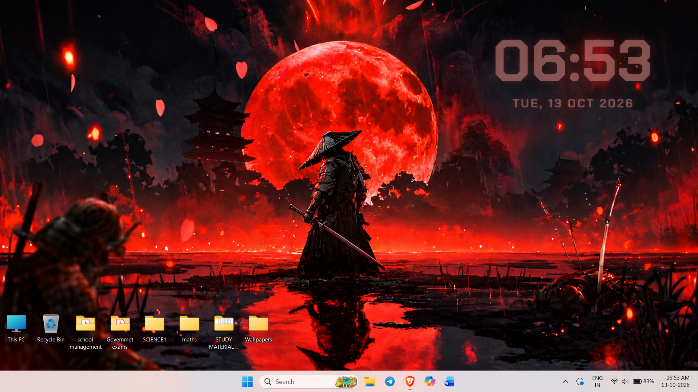

# Neon Clock

A minimal, glowing desktop clock for Windows that sits on your wallpaper and adapts to it. Written in a single PowerShell script. No installer, no dependencies, no background services.



## Features

- **Wallpaper-aware color.** The clock samples your current wallpaper, picks its dominant vivid color, lightens it, and tints the text with it. Change your wallpaper and the clock follows within a few seconds.
- **Right-click settings panel.** A dark, modern UI to customize everything live, with no file editing.
- **Separate styling for time and date.** Each gets its own font, size and opacity.
- **Four color modes:**
  - **Wallpaper:** auto tint, with a lightness slider.
  - **Default:** semi-transparent white.
  - **Custom:** preset swatches, a hex field, or the full color picker.
  - **Image:** fill the text with any picture you choose.
- **Glow control.** Adjust the neon glow strength, or turn it off.
- **Font picker.** Searchable list of every installed font, each previewed in its own typeface.
- **24-hour / 12-hour** toggle.
- **Drag to move.** Your position is remembered.
- **Stays on the desktop.** It sits above the wallpaper and below your apps, and does not appear in Alt+Tab.
- **Remembers your settings** between launches.

## Requirements

- Windows 10 or 11
- Windows PowerShell 5.1 (included with Windows)
- Optional: the [Chakra Petch](https://fonts.google.com/specimen/Chakra+Petch) font for the default squared look. Without it, the clock falls back to Bahnschrift.

## Quick start

### Method 1 (Recommended)
1. Download `Neon-Clock.ps1` and `Launch Clock.vbs` into the same folder.
2. Double-click `Launch Clock.vbs`.

The clock appears in the top-right corner of your primary screen.

### Method 2 
Open PowerShell in the folder and run:

```powershell
Set-ExecutionPolicy -Scope Process Bypass
.\Neon-Clock.ps1
```

The first command does not change your system policy. Running this way keeps the console open, so any startup error is shown there.

## Usage

| Action | What it does |
| --- | --- |
| **Left-click and drag** | Move the clock. The position is saved. |
| **Right-click** | Open the settings panel. |
| **Quit clock** (in settings) | Close the widget. |

### Settings panel

| Section | Options |
| --- | --- |
| **Editing** | Switch between the **Time** and **Date & day** lines. Font, size and opacity apply to the one selected. |
| **Font** | Search and pick any installed font. |
| **Size / Opacity** | Sliders for the selected line. |
| **Color** | Wallpaper, Default, Custom or Image mode. |
| **Glow** | Neon glow strength (0 turns it off). |
| **24-hour time** | Toggle between 24-hour and 12-hour display. |
| **Reset** | Restore all defaults (your position is kept). |

> **Image mode:** the picture fills the text and the glow is turned off in this mode. The image is stretched across each line separately, so the time and the date each show the full image.

## Run at startup

The repo includes `Launch Clock.vbs`, a launcher that starts the clock with no console window. Keep it in the same folder as `Neon-Clock.ps1`.

1. Press `Win + R`, type `shell:startup`, and press Enter.
2. Right-click `Launch Clock.vbs`, choose **Create shortcut**, and move the shortcut into the Startup folder.

To stop the clock, right-click it and choose **Quit clock** in the settings panel.

## Files it creates

Both files are created next to the script:

| File | Purpose |
| --- | --- |
| `Neon-Clock.settings.json` | Your saved settings. Delete it to start fresh. |
| `Neon-Clock.log` | Diagnostic log. Useful when reporting a bug. |

## Customizing the defaults

Default values (fonts, sizes, opacity, glow, starting position) live in the `$Defaults` block near the top of the script. They apply on first launch and when you press **Reset**.

If you want the clock to float above other windows instead of sitting on the desktop, set this near the top of the script:

```powershell
$AlwaysOnTop = $true
```

## Known limitations

- Placement and sizing are based on the **primary monitor**.
- **Show desktop** (`Win + D`) may minimize the clock, because Windows treats it like any other window.
- The wallpaper tint reads the image Windows uses for your desktop. Solid-color backgrounds fall back to white.

## Troubleshooting

- **"Running scripts is disabled" / "not digitally signed":** run `Set-ExecutionPolicy -Scope Process Bypass` in the same PowerShell window first, as shown in Quick start.
- **Clock is not visible:** check `Neon-Clock.log` next to the script, and open an issue with its contents.
- **Colors look washed out:** open settings, choose **Wallpaper**, and lower the **Lightness** slider.
- **Colors look too faint:** raise the **Opacity** slider for the time or date line.

## Contributing

Issues and pull requests are welcome. The whole widget is a single `.ps1` file: WPF for the UI, a few Win32 calls to keep the window on the desktop layer.

## License

Add your license here (for example, MIT).